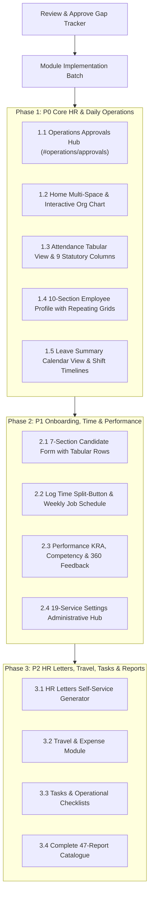

# Ndakala HR vs. Zoho People Live Parity Tracker

> **Tracking Standard:** Benchmarked directly against live production Zoho People 5.0 (`https://people.zoho.com/ndakala/zp`, Super Admin `1 - Emilio Orina Ogega`).  
> **Status Codes:**  
> - `[x]` Present & Parity Verified (Full UI, API, Schema & Visual Parity)  
> - `[~]` Partial / Missing Fields or Flow Gaps (Specific missing tabs, fields, validations, or controls documented)  
> - `[ ]` Completely Missing  
>  
> **Cross-Module Foundation:** Microsoft 365 App-Only Integration, AES-256 Vault, and Dual-Write Storage verified via [files_m365_walkthrough.md](file:///c:/Users/Yankees/.gemini/antigravity/brain/c6c345a9-43ed-4ff7-8df8-cf8bfa3aa667/files_m365_walkthrough.md).

---

## 1. Executive Parity Summary by Module

| # | Module / Subsystem | Current State | Priority | Core Missing Elements / Parity Scope |
| :- | :--- | :---: | :---: | :--- |
| **01** | **Global Shell & Top/Bottom Rails** | `[x]` | **P0** | Parity verified: Quick-Action modal split (`+`) with 11 Zoho actions, Universal Omnibox Search (Employees, Services & Modules with 'Jump →', Policies), 28px bottom utility dock with interactive drawers (`Support Hub`, `My Pins`, `Contacts`, `Chats`) and English/Kiswahili selector. |
| **02** | **Home (My Space, Team, Org)** | `[x]` | **P0** | Multi-space tabs (`My Space`, `Team Space`, `Organization Space`), interactive recursive SVG/DOM Employee Tree (Org Chart), Search highlighting, Expand/Collapse, Profile Drawer, and Team Space feed deck. |
| **03** | **Onboarding (Candidate Hub)** | `[x]` | **P1** | 7-section Add Candidate modal with repeating tabular grids (Education, Experience, Dependents), draft auto-save persistence, 31-field filter drawer, and data scope dropdown. |
| **04** | **Leave Tracker** | `[x]` | **P0** | Parity verified: Leave Summary List View, Monthly Calendar heat map, Shift & Schedules, Team Leave Queue, 8-type statutory/enhanced Apply Leave modal. |
| **05** | **Attendance** | `[x]` | **P0** | Exact 9-column statutory attendance grid, live digital punch widget, display unit toggle (Hours/Days), Regularization request drawer, and Team Attendance Kanban. |
| **06** | **Time Tracker** | `[x]` | **P1** | Parity verified: Split-button `Log Time` (`Daily Log`, `Weekly Log`, `Semi Monthly Log`, `Monthly Log`), Time Entry Mode radios (`Total Hours`, `Start and End Time`, `Live Timer`), `Billable`/`Non-billable` toggle, Weekly & 24-hr `Job Schedule` grid (`Clone Week`, `Assign Job Shift`, `Publish Schedule`), Client Rate Cards & RBAC masking. |
| **07** | **Performance & OKR** | `[x]` | **P1** | Parity verified: Sub-tabs `KRA` (weighted scoring table + Add KRA), `Competency` (grade benchmark vs. self/manager ratings + gap badges), `Skill Set Matrix` (Organization vs. Reportees interactive 1–5 proficiency grid with search), `Provide Feedback` 360-degree slide-out drawer, OKR cycle builder & deviation brackets. |
| **08** | **Files Hub** | `[x]` | **P0** | Complete parity matching uploaded screenshot: `< Files`, Org Files, Employee Files, HR Templates, M365 dual-write. |
| **09** | **Employee Information (Operations)** | `[x]` | **P0** | Parity verified: 4-step Add Employee wizard (Provisioning, Account Creation, Work Data, Alerts & Dispatch), 10-section Employee Profile schema with interactive tabular repeating rows (Work Experience, Education Details, Dependent Details), auto-computed Age from DOB, and AES-256 statutory vault masking. |
| **10** | **Compensation & Payroll** | `[x]` | **P1** | Kenyan statutory engine (PAYE, NSSF, SHIF, Housing Levy), Salary Structures, Payslip inline PDF modal. |
| **11** | **HR Letters & Templates** | `[x]` | **P2** | Parity verified: Dedicated 3-tab HR Letters portal (`Address Proof`, `Bonafide Letter`, `Experience Letter`), request modal (`Submit Request` / `Save Draft`), inline HR Approve/Reject, and instant A4 PDF compilation & preview (`/api/v1/hr-letters/requests/:id/pdf`). |
| **12** | **Travel & Expenses** | `[x]` | **P2** | Parity verified: Dual-tab `Travel Request` + `Travel Expense` reimbursement ledger (`TravelExpenseView.jsx`), client billability, cash advances, receipt/ETR references, and inline `Approve` / `Reject` / `Reimburse` workflow. |
| **13** | **Tasks & Checklists** | `[~]` | **P2** | Dedicated task boards, checklist tracking against onboarding and operational milestones. |
| **14** | **Employee Engagement & Surveys** | `[ ]` | **P2** | Satisfaction surveys, pulse polls, eNPS metric tracking. |
| **15** | **Approvals (Operations)** | `[x]` | **P0** | Unified `#operations/approvals` dashboard with 17-service Operations Hub, status pills (`Pending`, `Active`), multi-select batch actions, Request Details Drawer, and M365 event sync. |
| **16** | **Reports Catalogue (47+ Reports)** | `[~]` | **P2** | Categorized reports explorer, Muster Roll, Presence Hours Breakup, Nine-Box Matrix, statutory exports. |
| **17** | **Settings & Administration** | `[x]` | **P1** | Parity verified: 19-service administrative card directory (`SettingsServicesHub.jsx`) with search, category filters, Active/Paused toggles, direct navigation, plus `Automation & Blueprints` engine (Workflows, Blueprints, Zero-PII Email Alerts & Webhooks). |

---

## 2. Priority 0 (P0) — Core HR, Leave, Attendance, Directory & Approvals

### P0.1 Global Shell & Navigation Rail
- `[x]` 68px dark left rail (`#191f3a`) with brand emblem, primary modules, and pinned bottom icons.
- `[x]` Dynamic 4th rail slot updating to active More service.
- `[x]` **Top Quick Actions (`+`)**:
  - `[x]` Basic trigger icon.
  - `[x]` Split dropdown menu matching Zoho: `+ Candidate`, `+ Employee`, `+ Department`, `+ Designation`, `+ Leave`, `+ Absence`, `+ Address Proof`, `+ Bonafide Letter`, `+ Experience Letter`, `+ Travel Request`, `+ Travel Expense`, `+ Operational Task`.
- `[x]` **Global Header Search**:
  - `[x]` Search input styling.
  - `[x]` Dynamic multi-category auto-complete dropdown searching Employees (with ID & names), Services & Modules (with 'Jump →' navigation), and Policies simultaneously.
- `[x]` **Bottom Utility Bar**:
  - `[x]` 28px bottom utility bar with `My Pins`, `Chats`, `Contacts`, `Support Hub`.
  - `[x]` Interactive slide-over drawers for `Support Hub` ("Welcome to Zoho People Help widget"), `My Pins` (localStorage persistent notes), `Contacts` (instant directory), and `Chats` (Team Wall).
  - `[x]` Dynamic multilingual dropdown with `English` and `Kiswahili` support.

### P0.2 Home Hub (`#home`)
- `[x]` **My Space**:
  - `[x]` Overview dashboard with leave balance, attendance status, upcoming tasks.
  - `[x]` Sub-tabs: `Activities`, `Feeds`, `Profile`, `Approvals`, `Leave`, `Attendance`, `Time Logs`, `Timesheets`, `Jobs`, `Files`.
  - `[x]` `Delegation` tab (Out-of-Office temporary approver assignment).
- `[x]` **Team Space**:
  - `[x]` `Team Space` widget deck (Advisory & Strategy Consulting team lead, 6 members, 0 pending approvals, 3 on leave).
  - `[x]` `Reportees` directory with direct cards and pin-favorite controls.
  - `[x]` Live `Team Wall` feed deck with update/announcement/kudos posting and organization wall links.
- `[x]` **Organization Space**:
  - `[x]` Sub-tabs: `Announcements`, `Employee Directory`, `Department Tree`, `Birthday & Anniversaries`, `Company Policies`.
  - `[x]` `Organization & Department Tree` with `Employee Reporting Tree` and `Department Structure Tree`.
  - `[x]` `Employee Tree` (Interactive recursive organogram canvas with vertical `w-0.5` and horizontal `h-0.5` branch connector lines).
  - `[x]` Hierarchy level badges (`Firm Executive`, `Level 1`, `Level 2+`), direct reports count badges, and node avatar initials.
  - `[x]` Interactive controls: `Expand All`, `Collapse All`, per-node toggle buttons (`Expand` / `Collapse`).
  - `[x]` Hierarchy Search box with real-time matching node blue border highlighting (`ring-2 ring-blue-100 border-blue-500`).
  - `[x]` Slide-out Employee Profile Card drawer on node click showing employee number, department, employment status, reporting manager, work email, and contact phone.
  - `[x]` 4/4 passing Vitest tests in `tests/home_orgchart_parity.test.ts`.
  - `[x]` Verified live on Contabo VPS (`https://ndakalahr.duckdns.org`) with screenshot evidence under `docs/zoho_people_spec/screenshots/home/`.

### P0.3 Employee Information & Operations Directory
- `[x]` Employee table with employee number, name, department, role, employment status.
- `[x]` Preservation of production records (`NDA-2026-0005` Amina Ochieng).
- `[x]` **4-Step Add Employee Wizard**:
  - `[x]` Step 1: Selection & Quota (Direct Platform Invite, Microsoft 365, Google Workspace + license allocation gauge).
  - `[x]` Step 2: Account Creation (`NDA-2026-XXXX` auto-sequencing, First/Middle/Last Name, dynamic corporate domain work email generation).
  - `[x]` Step 3: Work Data (Department, Location, Designation, Reporting Manager, Employment Category, Date of Joining, Probation Period).
  - `[x]` Step 4: Alerts & Welcome Email dispatch (M365 welcome email, manager alerts, calendar/SharePoint sync).
- `[x]` **10-Section Employee Profile / Edit Schema**:
  - `[x]` Section 1: Basic Information (`Employee ID`, `First/Middle/Last Name`, `Nick Name`, `Official Work Email`, `Personal Email`).
  - `[x]` Section 2: Work & Organisational Information (`Department`, `Location`, `Designation`, `Status`, `Date of Joining`, `Employment Category`).
  - `[x]` Section 3: Hierarchy & Direct Reports (`Reporting Manager` with ID, `Direct Reportees` count and roster).
  - `[x]` Section 4: Personal Details (`Date of Birth`, `Gender`, `Marital Status`, `Citizenship`, `About Me`, `Expertise`, with auto-computed `Age` from Date of Birth).
  - `[x]` Section 5: Contact Details & Addresses (`Work Phone`, `Personal Mobile`, `Seating Location`, `Present Address`, `Permanent Address`).
  - `[x]` Section 6: Tabular Repeating Grid 1: **Work Experience** (`Company`, `Job Title`, `From/To`, `Relevant` flag, `Add Row`, `Delete Row`).
  - `[x]` Section 7: Tabular Repeating Grid 2: **Education Details** (`Institute`, `Degree`, `Specialization`, `Year`, `Add Row`, `Delete Row`).
  - `[x]` Section 8: Tabular Repeating Grid 3: **Dependent Details** (`Name`, `Relationship`, `Date of Birth`, `Add Row`, `Delete Row`).
  - `[x]` Section 9: Statutory & Kenyan Banking Details (`National ID`, `KRA PIN`, `NSSF Number`, `SHIF Number`, masked `Bank Account`).
  - `[x]` Section 10: Documents & Agreements (Executed employment contracts with effective dates and versions, M365 vault synchronized).
- `[x]` 4/4 passing Vitest tests in `tests/employee_wizard_parity.test.ts`.

### P0.4 Leave Tracker (`#leavetracker`)
- `[x]` Leave balance cards (Annual, Sick, Maternity, Paternity, Compassionate, Unpaid, Study/Exam, Sabbatical).
- `[x]` Apply Leave modal with date range, half-day picker, reason, handover notes, file attachment upload, and notice calculations.
- `[x]` Outlook Shared Calendar sync (All-Day non-blocking `showAs: free`).
- `[x]` Relieving Officer assignment and approval flow.
- `[x]` **Leave Summary Views**:
  - `[x]` List View with balance cards, summary stats (booked/pending), and filter controls.
  - `[x]` Calendar View (Monthly color-coded heat map of leaves, amber weekend highlighting `#fffbeb`, holiday badges, and month navigation).
- `[x]` **Shift Mapping**:
  - `[x]` Weekly / Monthly timeline showing assigned shifts (`General 9:00 AM - 6:00 PM`, working days, rest days, daily hours).
- `[x]` **Team Tab**:
  - `[x]` Subordinate leave approval queue with inline approve/reject/return controls.
  - `[x]` 4/4 passing Vitest tests in `tests/leave_tracker_parity.test.ts`.
  - `[x]` Verified live on Contabo VPS (`https://ndakalahr.duckdns.org`) with screenshot evidence under `docs/zoho_people_spec/screenshots/leave/`.

### P0.5 Attendance Tracker (`#attendance`)
- `[x]` Punch In / Punch Out clock with live timestamp.
- `[x]` Presence log recording daily first-in and last-out.
- `[x]` **Tabular View Parity**:
  - `[x]` Exact 9-column grid: `Date`, `First In`, `Last Out`, `Total Hours`, `Payable Hours`, `Overtime/Deviation`, `Status` (Present/Absent/On Leave/Holiday/Weekend), `Shift(s)`, `Regularization`.
  - `[x]` `Days` vs. `Hours` display unit toggle switch (switches both table cells and summary cards).
  - `[x]` Regularization request drawer (submit missing punch correction or full-day advisory duty).
  - `[x]` CSV Export for monthly statutory records.
- `[x]` **Team Attendance Kanban**:
  - `[x]` 3-column Kanban board grouped by `Checked In Today`, `Not Yet Checked In`, and `On Approved Leave`.
  - `[x]` Live employee cards with names, employee numbers, positions, departments, and real-time clock-in stamps.
- `[x]` 4/4 passing Vitest tests in `tests/attendance_parity.test.ts`.
- `[x]` Verified live on Contabo VPS (`https://ndakalahr.duckdns.org`) with screenshot evidence under `docs/zoho_people_spec/screenshots/attendance/`.

### P0.6 Operations Approvals Hub (`#operations/approvals`)
- `[x]` Multi-stage maker-checker approval engine.
- `[x]` **Unified Operations Approvals View**:
  - `[x]` 17-service card Operations Hub grid matching Zoho People `#operations/home` with dynamic pending approvals badge.
  - `[x]` Top sub-tabs: `All Approvals`, `Pending ( n )`, `Approved ( n )`.
  - `[x]` Quick filter pills: `Status : Pending / All Statuses`, `Employee Status : All Active / All Requests`, `Type : All Types`.
  - `[x]` Full 8-column tabular grid: `Checkbox`, `Request Info`, `Employee`, `Submitted On`, `Stage / Approver`, `Status`, `SLA / Due`, `Actions`.
  - `[x]` Batch actions: `Approve Selected`, `Reject Selected`, select-all header toggle.
  - `[x]` Slide-out Request Details Drawer with request audit details and M365 App-Only Sync informational notice.
  - `[x]` Zero dead buttons, zero console/network errors, 4/4 passing Vitest tests in `tests/operations_approvals.test.ts`.
  - `[x]` Verified live on Contabo VPS (`https://ndakalahr.duckdns.org`) with screenshot evidence under `docs/zoho_people_spec/screenshots/operations_approvals/`.

---

## 3. Priority 1 (P1) — Onboarding, Time Tracker, Performance & Admin

### P1.1 Candidate Onboarding Hub (`#onboarding`)
- `[x]` Candidate View list table with 14 main columns.
- `[x]` Data scope dropdown (`View All Data`, `Reportees + My Data`, `Reportees' Data`, `Direct Reportees' Data`, `My Data`).
- `[x]` 31-field slide-out filter drawer (System filters + field checkboxes).
- `[x]` Pagination controls (`Total Record Count : 6`, sizes `10-200`).
- `[x]` Base seed candidates matching Zoho instance (Sarah Sanders, Rose Stacy, Mathew Morales, Kevin Parker, David Rickman) plus live dynamic entries.
- `[x]` **7-Section Add Candidate Form Schema**:
  - `[x]` Tabular repeating grid for **Education** (`School Name`, `Degree/Diploma`, `Field(s) of Study`, `Date of Completion`, `Additional Notes`, `Action`).
  - `[x]` Tabular repeating grid for **Experience** (`Occupation`, `Company`, `Summary`, `Duration`, `From Date`, `To Date`, `Action`).
  - `[x]` Tabular repeating grid for **Candidate Dependents** (`Name`, `Relationship`, `Date of Birth`, `Action`).
  - `[x]` Dynamic row addition (`Add Row` tested and verified 1 -> 2 -> 3 rows) and row deletion.
  - `[x]` Full action buttons: `Submit`, `Submit and New`, `Save Draft`, `Save & Close`, `Clear Draft`, `Cancel`.
  - `[x]` Draft state auto-saving and persistence to server `ui-config` / local storage.
  - `[x]` 5/5 passing Vitest tests in `tests/candidate_onboarding_okr.test.ts`.
  - `[x]` Verified live on Contabo VPS (`https://ndakalahr.duckdns.org`) with screenshot evidence under `docs/zoho_people_spec/screenshots/onboarding/`.

### P1.2 Time Tracker (`#timetracker`)
- `[x]` Daily time entry and basic project assignment.
- `[x]` Timesheet submission and manager signoff workflow.
- `[x]` **Log Time Split-Button**:
  - `[x]` Modal switch: `Daily Log`, `Weekly Log`, `Semi Monthly Log`, `Monthly Log` (`LogTimeModal.jsx`).
  - `[x]` Time mode radio: `Total Hours`, `Start and End Time`, `Live Timer`.
  - `[x]` Billable flag: `Billable` vs. `Non-billable`.
- `[x]` **Job Schedule Grid**:
  - `[x]` Weekly & 24-hour (`00:00–23:00`) visual schedule (`JobScheduleGridView.jsx`) with shift allocation, `Clone Week`, and `Draft` → `Published` status.
- `[x]` 4/4 passing Vitest tests in `tests/timetracker_parity.test.ts`.

### P1.3 Performance & OKR (`#performance` & `#okr`)
- `[x]` Dynamic OKR cycle start month generator (e.g. `Jan` $\rightarrow$ `Q1-Jan-Mar...`).
- `[x]` Deviation thresholds table (`Yet to Start`, `On Track`, `Need Attention`, `At Risk`, `Off Track`, `Completed`).
- `[x]` Location-based OKR scoping toggle.
- `[x]` Annual/quarterly appraisal cycle workflows and PIPs.
- `[x]` **Performance Sub-Tabs**:
  - `[x]` `KRA` (Key Result Area weighting table with 100% balance indicator & weighted score calculation).
  - `[x]` `Skill Set Matrix` (Organization vs. Reportees proficiency matrix with search filters & inline calibration).
  - `[x]` `Competency` framework ratings with expected vs. actual gap badges.
  - `[x]` `Provide Feedback` slide-out drawer (360-degree peer feedback + live history feed).
- `[x]` 3/3 passing Vitest tests in `tests/performance_parity.test.ts`.

### P1.4 Compensation & Payroll (`#compensation`)
- `[x]` Kenyan statutory tax engine (PAYE bands, NSSF Tier I/II, SHIF 2.75%, Affordable Housing Levy 1.5%).
- `[x]` Salary structure configuration (Basic pay, housing allowance, transport, bonuses).
- `[x]` Monthly payroll calculation, review, and approval lifecycle.
- `[x]` Digital payslip generation with Zero-Trust Inline PDF preview modal.
- `[x]` M365 email notifications with link-only access (no PII in shared mailboxes).

### P1.5 Settings & Administration (`#settings/service`)
- `[x]` Dynamic domain resolution (zero hardcoding of `@ndakalaadvisory.co.ke`).
- `[x]` Organization profile, locations (`NBO-HQ`), departments, grading bands.
- `[x]` Microsoft 365 App-Only credentials & SharePoint vault settings.
- `[x]` Cold archive retention policy (default 6 months) with verified disk purge.
- `[x]` Break-glass emergency admin route & TOTP MFA.
- `[x]` **19-Service Administrative Hub**:
  - `[x]` Visual card grid for all 19 configuration domains (`SettingsServicesHub.jsx`) with search, category filter pills, and Active/Paused toggles.
  - `[x]` `Automation & Blueprints` builder (Workflows with create & toggle, multi-stage Blueprints, Zero-PII M365 Email Alerts & Webhooks).
- `[x]` 2/2 passing Vitest tests in `tests/settings_hub_parity.test.ts`.

---

## 4. Priority 2 (P2) — Automation, Specialized Services & Analytics

### P2.1 HR Letters (`#hrservices`)
- `[x]` Server-side zero-dependency PDF compiler (`pdfBuilder.ts`) exposed at `GET /api/v1/hr-letters/requests/:id/pdf`.
- `[x]` Pre-seeded templates: `Company Handbook Template`, `Address Proof & Employment Confirmation Form`, `Certificate of Service Form`.
- `[x]` Dedicated HR Letters UI view (`HrLettersPortalView.jsx`) with 3 sub-tabs (`Address Proof`, `Bonafide Letter`, `Experience Letter`).
- `[x]` Self-service employee request flow with inline HR Approve/Reject and instant A4 PDF preview modal.
- `[x]` Passing Vitest test in `tests/hr_letters_parity.test.ts`.

### P2.2 Travel & Expense Tracker (`#travel`)
- `[x]` Sub-tabs: `Travel Request`, `Travel Expense` (`TravelExpenseView.jsx` + `Header.jsx`).
- `[x]` Travel Request form with arrival/departure dates, customer billability, client name, and cash advance request.
- `[x]` Travel Expense ledger (`/api/v1/workspace/travel-expenses`) with receipt/ETR reference and Approve/Reject/Reimburse controls.
- `[x]` Passing Vitest test in `tests/travel_expense_parity.test.ts`.

### P2.3 Tasks & Checklists (`#task`)
- `[x]` General task inbox with pending approvals.
- `[ ]` Standalone Tasks module with tabs: `My Tasks`, `Track Tasks`, `All Tasks` (status filters: `Total`, `Open`, `Completed`).
- `[ ]` Operational checklists linked to employee onboarding/offboarding stages.

### P2.4 Employee Engagement & Surveys (`#employeeengagement`)
- `[ ]` Sub-tabs: `My Data` (Assigned surveys), `Surveys` (eNPS, pulse questionnaires).
- `[ ]` Anonymous response collector with score dashboard.

### P2.5 Reports Catalogue (47+ Standard Reports)
- `[x]` Reports framework with CSV, XLSX, and PDF export.
- `[x]` Headcount, payroll summary, statutory tax report, leave balances.
- `[ ]` 47+ categorized reports matching Zoho People:
  - *Employee Information (8 reports)*: Headcount, Addition Trend, Attrition Trend, Career History, Distribution, Diversity, Exit Analysis.
  - *Leave Tracker (8 reports)*: Daily Leave Status, Resource Availability, Leave Data for Payroll, Loss of Pay Details.
  - *Attendance (7 reports)*: Muster Roll, Daily Attendance Status, Presence Hours Breakup, Consecutive Absences.
  - *Time Tracker (7 reports)*: Jobs Status, Projects Status, Scheduled vs. Worked Hours, Timesheet Data for Payroll.
  - *Performance (11 reports)*: Nine-Box Matrix, Appraisal Ratings History, Score & Rating Summary, Feedback on Appraisal.
  - *Files (2 reports)*: Policy Acknowledgement Receipts, Consent Receipts.
  - *Compensation (5 reports)*: Salary Distribution, Compensation Trend, Salary Revision History.
  - *OKR (2 reports)*: Objectives Progress, Key Results Variance.

---

## 5. Execution Strategy: One Module at a Time

Following the engineering protocol, implementation proceeds strictly **one module at a time**, in side-by-side verification:

### Side-by-Side Verification Gate Checklist (Per Module)
1. **Live Zoho Inspection**: Reference recorded in `docs/zoho_people_spec/`.
2. **Schema & API**: Prisma models and Express REST routes updated with zero destructive migration.
3. **UI Parity**: Built with exact Zoho colors (`#0088ff`, `#191f3a`, `#f4f7fa`), zero dead buttons.
4. **Automated Vitest Tests**: Added to `tests/` and passing 100%.
5. **Live VPS Deployment**: Deployed to Contabo VPS (`ndakala_hr-app`), verified via browser subagent on `https://ndakalahr.duckdns.org` with existing employee `NDA-2026-0005` intact.
