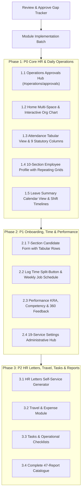

# Ndakala HR vs. Zoho People Live Parity Tracker

> **Tracking Standard:** Benchmarked directly against live production Zoho People 5.0 (`https://people.zoho.com/ndakala/zp`, Super Admin `1 - Emilio Orina Ogega`).  
> **Status Codes:**  
> - `[x]` Present & Parity Verified (Full UI, API, Schema & Visual Parity)  
> - `[~]` Partial / Missing Fields or Flow Gaps (Specific missing tabs, fields, validations, or controls documented)  
> - `[ ]` Completely Missing  
>  
> **Cross-Module Foundation:** Microsoft 365 App-Only Integration, AES-256 Vault, and Dual-Write Storage verified via [files_m365_walkthrough.md](file:///c:/Users/Yankees/.gemini/antigravity/brain/c6c345a9-43ed-4ff7-8df8-cf8bfa3aa667/files_m365_walkthrough.md).

---

## 1. Executive Parity Summary by Module

| # | Module / Subsystem | Current State | Priority | Core Missing Elements / Parity Scope |
| :- | :--- | :---: | :---: | :--- |
| **01** | **Global Shell & Top/Bottom Rails** | `[~]` | **P0** | Quick-Action modal split (`+`), Global Employee Search, Bottom utility pins (`My Pins`, `Support Hub`). |
| **02** | **Home (My Space, Team, Org)** | `[~]` | **P0** | Multi-space tabs (`My Space`, `Team`, `Organization`), interactive Employee Tree (Org Chart), Department Directory. |
| **03** | **Onboarding (Candidate Hub)** | `[~]` | **P1** | 7-section Add Candidate modal/drawer with repeating tabular grids (Education, Experience, Dependents). |
| **04** | **Leave Tracker** | `[~]` | **P0** | `Leave Summary` Calendar vs. List toggle, `Shift` weekly/monthly timeline, `Team` On-Leave calendar. |
| **05** | **Attendance** | `[x]` | **P0** | Exact 9-column statutory attendance grid, live digital punch widget, display unit toggle (Hours/Days), Regularization request drawer, and Team Attendance Kanban. |
| **06** | **Time Tracker** | `[~]` | **P1** | Split-button `Log Time` (Daily/Weekly/Monthly), Job Schedule 24-hr weekly grid, Client Rate Cards. |
| **07** | **Performance & OKR** | `[~]` | **P1** | Sub-tabs `KRA`, `Competency`, `Skill Set Matrix` (Organization vs. Reportees rating grid). |
| **08** | **Files Hub** | `[x]` | **P0** | Complete parity matching uploaded screenshot: `< Files`, Org Files, Employee Files, HR Templates, M365 dual-write. |
| **09** | **Employee Information (Operations)** | `[~]` | **P0** | 4-step Add Employee wizard, 10-section Employee Profile schema with tabular repeating rows (Experience, Education, Dependents). |
| **10** | **Compensation & Payroll** | `[x]` | **P1** | Kenyan statutory engine (PAYE, NSSF, SHIF, Housing Levy), Salary Structures, Payslip inline PDF modal. |
| **11** | **HR Letters & Templates** | `[~]` | **P2** | Dedicated UI generator for Address Proof, Bonafide Letter, Experience Letter (backend PDF compiler ready). |
| **12** | **Travel & Expenses** | `[ ]` | **P2** | Travel Request form, Travel Expense reimbursement ledger, billable-to-client approvals. |
| **13** | **Tasks & Checklists** | `[~]` | **P2** | Dedicated task boards, checklist tracking against onboarding and operational milestones. |
| **14** | **Employee Engagement & Surveys** | `[ ]` | **P2** | Satisfaction surveys, pulse polls, eNPS metric tracking. |
| **15** | **Approvals (Operations)** | `[x]` | **P0** | Unified `#operations/approvals` dashboard with 17-service Operations Hub, status pills (`Pending`, `Active`), multi-select batch actions, Request Details Drawer, and M365 event sync. |
| **16** | **Reports Catalogue (47+ Reports)** | `[~]` | **P2** | Categorized reports explorer, Muster Roll, Presence Hours Breakup, Nine-Box Matrix, statutory exports. |
| **17** | **Settings & Administration** | `[~]` | **P1** | 19-service administrative card grid, Custom Services builder, granular Role-Based Access Control matrix. |

---

## 2. Priority 0 (P0) — Core HR, Leave, Attendance, Directory & Approvals

### P0.1 Global Shell & Navigation Rail
- `[x]` 68px dark left rail (`#191f3a`) with brand emblem, primary modules, and pinned bottom icons.
- `[x]` Dynamic 4th rail slot updating to active More service.
- `[~]` **Top Quick Actions (`+`)**:
  - `[x]` Basic trigger icon.
  - `[ ]` Split dropdown menu matching Zoho: `Candidate`, `Employee`, `Department`, `Designation`, `Leave`, `Address Proof`, `Bonafide Letter`, `Experience Letter`, `Travel Request`, `Travel Expense`, `Task`.
- `[~]` **Global Header Search**:
  - `[x]` Search input styling.
  - `[ ]` Dynamic auto-complete dropdown searching employees, departments, and services simultaneously.
- `[~]` **Bottom Utility Bar**:
  - `[x]` Static bottom footer with `My Pins`, `Chats`, `Contacts`, `Support Hub`.
  - `[ ]` Active slide-over drawer for `Support Hub` and quick notes (`My Pins`).

### P0.2 Home Hub (`#home`)
- `[~]` **My Space**:
  - `[x]` Overview dashboard with leave balance, attendance status, upcoming tasks.
  - `[ ]` Sub-tabs: `Activities`, `Feeds`, `Profile`, `Approvals`, `Leave`, `Attendance`, `Time Logs`, `Timesheets`, `Jobs`, `Files`.
  - `[ ]` `Delegation` tab (Out-of-Office temporary approver assignment).
- `[~]` **Team Space**:
  - `[ ]` `Team Space` widget deck (Team strength, Team Availability gauge, Location Diversity).
  - `[ ]` `Department Directory` with direct-dial and check-in badges.
- `[~]` **Organization Space**:
  - `[ ]` `Employee Tree` (Interactive zoomable SVG organogram).
  - `[ ]` `Announcements` wall & `Birthday Folks` / `New Hires` widget cards.

### P0.3 Employee Information & Operations Directory
- `[x]` Employee table with employee number, name, department, role, employment status.
- `[x]` Preservation of production records (`NDA-2026-0005` Amina Ochieng).
- `[~]` **4-Step Add Employee Wizard**:
  - `[ ]` Step 1: Selection (Invitation, Zoho Mail, Google Workspace, Microsoft 365 + quota gauge).
  - `[ ]` Step 2: Account Creation (Employee ID auto-generation rule, First/Last Name, Email).
  - `[ ]` Step 3: Work Data (Department, Location, Designation, Reporting Manager).
  - `[ ]` Step 4: Alerts & Welcome Email dispatch.
- `[~]` **10-Section Employee Profile / Edit Schema**:
  - `[x]` Basic Information (`Employee ID`, `First/Last Name`, `Email`).
  - `[x]` Work Information (`Department`, `Location`, `Designation`, `Status`, `Date of Joining`).
  - `[x]` Hierarchy (`Reporting Manager`).
  - `[~]` Personal Details (`Date of Birth`, `Gender`, `Marital Status`, `About Me`, `Expertise`). Missing auto-computed `Age`.
  - `[~]` Contact Details (`Work Phone`, `Extension`, `Seating Location`, `Tags`, `Present/Permanent Address`).
  - `[ ]` Tabular Repeating Grid 1: **Work Experience** (`Company`, `Job Title`, `From/To`, `Relevant` flag).
  - `[ ]` Tabular Repeating Grid 2: **Education Details** (`Institute`, `Degree`, `Specialization`, `Year`).
  - `[ ]` Tabular Repeating Grid 3: **Dependent Details** (`Name`, `Relationship`, `Date of Birth`).

### P0.4 Leave Tracker (`#leavetracker`)
- `[x]` Leave balance cards (Annual, Sick, Maternity, Paternity, Compassionate, Unpaid).
- `[x]` Apply Leave modal with date range, half-day picker, reason, handover notes.
- `[x]` Outlook Shared Calendar sync (All-Day non-blocking `showAs: free`).
- `[x]` Relieving Officer assignment and approval flow.
- `[~]` **Leave Summary Views**:
  - `[x]` List View.
  - `[ ]` Calendar View (Monthly color-coded heat map of leaves).
- `[~]` **Shift Mapping**:
  - `[ ]` Weekly / Monthly timeline showing assigned shifts (`General 9:00 AM - 6:00 PM`).
- `[~]` **Team Tab**:
  - `[ ]` `On Leave` team schedule widget.
  - `[ ]` Subordinate leave approval queue with inline approve/reject.

### P0.5 Attendance Tracker (`#attendance`)
- `[x]` Punch In / Punch Out clock with live timestamp.
- `[x]` Presence log recording daily first-in and last-out.
- `[x]` **Tabular View Parity**:
  - `[x]` Exact 9-column grid: `Date`, `First In`, `Last Out`, `Total Hours`, `Payable Hours`, `Overtime/Deviation`, `Status` (Present/Absent/On Leave/Holiday/Weekend), `Shift(s)`, `Regularization`.
  - `[x]` `Days` vs. `Hours` display unit toggle switch (switches both table cells and summary cards).
  - `[x]` Regularization request drawer (submit missing punch correction or full-day advisory duty).
  - `[x]` CSV Export for monthly statutory records.
- `[x]` **Team Attendance Kanban**:
  - `[x]` 3-column Kanban board grouped by `Checked In Today`, `Not Yet Checked In`, and `On Approved Leave`.
  - `[x]` Live employee cards with names, employee numbers, positions, departments, and real-time clock-in stamps.
- `[x]` 4/4 passing Vitest tests in `tests/attendance_parity.test.ts`.
- `[x]` Verified live on Contabo VPS (`https://ndakalahr.duckdns.org`) with screenshot evidence under `docs/zoho_people_spec/screenshots/attendance/`.

### P0.6 Operations Approvals Hub (`#operations/approvals`)
- `[x]` Multi-stage maker-checker approval engine.
- `[x]` **Unified Operations Approvals View**:
  - `[x]` 17-service card Operations Hub grid matching Zoho People `#operations/home` with dynamic pending approvals badge.
  - `[x]` Top sub-tabs: `All Approvals`, `Pending ( n )`, `Approved ( n )`.
  - `[x]` Quick filter pills: `Status : Pending / All Statuses`, `Employee Status : All Active / All Requests`, `Type : All Types`.
  - `[x]` Full 8-column tabular grid: `Checkbox`, `Request Info`, `Employee`, `Submitted On`, `Stage / Approver`, `Status`, `SLA / Due`, `Actions`.
  - `[x]` Batch actions: `Approve Selected`, `Reject Selected`, select-all header toggle.
  - `[x]` Slide-out Request Details Drawer with request audit details and M365 App-Only Sync informational notice.
  - `[x]` Zero dead buttons, zero console/network errors, 4/4 passing Vitest tests in `tests/operations_approvals.test.ts`.
  - `[x]` Verified live on Contabo VPS (`https://ndakalahr.duckdns.org`) with screenshot evidence under `docs/zoho_people_spec/screenshots/operations_approvals/`.

---

## 3. Priority 1 (P1) — Onboarding, Time Tracker, Performance & Admin

### P1.1 Candidate Onboarding Hub (`#onboarding`)
- `[x]` Candidate View list table with 14 main columns.
- `[x]` Data scope dropdown (`View All Data`, `Reportees + My Data`, `Reportees' Data`, `Direct Reportees' Data`, `My Data`).
- `[x]` 31-field slide-out filter drawer (System filters + field checkboxes).
- `[x]` Pagination controls (`Total Record Count : 5`, sizes `10-200`).
- `[x]` 5 base seed candidates matching Zoho instance.
- `[~]` **7-Section Add Candidate Form Schema**:
  - `[ ]` Tabular repeating grid for **Education** (`School`, `Degree`, `Field`, `Completion Date`, `Notes`).
  - `[ ]` Tabular repeating grid for **Experience** (`Occupation`, `Company`, `Summary`, `Dates`, `Currently Work Here`).
  - `[ ]` Tabular repeating grid for **Candidate Dependents** (`Name`, `Relationship`, `DOB`).
  - `[ ]` Split action buttons: `Submit`, `Submit and New`, `Save Draft`, `Cancel`.

### P1.2 Time Tracker (`#timetracker`)
- `[x]` Daily time entry and basic project assignment.
- `[x]` Timesheet submission and manager signoff workflow.
- `[~]` **Log Time Split-Button**:
  - `[ ]` Modal switch: `Daily Log`, `Weekly Log`, `Semi Monthly Log`, `Monthly Log`.
  - `[ ]` Time mode radio: `Total Hours`, `Start and End Time`, `Live Timer`.
  - `[ ]` Billable flag: `Billable` vs. `Non-billable`.
- `[~]` **Job Schedule Grid**:
  - `[ ]` Weekly 24-hour visual schedule with shift allocation and publish status.

### P1.3 Performance & OKR (`#performance` & `#okr`)
- `[x]` Dynamic OKR cycle start month generator (e.g. `Jan` $\rightarrow$ `Q1-Jan-Mar...`).
- `[x]` Deviation thresholds table (`Yet to Start`, `On Track`, `Need Attention`, `At Risk`, `Off Track`, `Completed`).
- `[x]` Location-based OKR scoping toggle.
- `[x]` Annual/quarterly appraisal cycle workflows and PIPs.
- `[~]` **Performance Sub-Tabs**:
  - `[ ]` `KRA` (Key Result Area weighting table).
  - `[ ]` `Skill Set Matrix` (Organization vs. Reportees proficiency matrix with search filters).
  - `[ ]` `Competency` framework ratings.
  - `[ ]` `Provide Feedback` slide-out drawer (360-degree peer feedback).

### P1.4 Compensation & Payroll (`#compensation`)
- `[x]` Kenyan statutory tax engine (PAYE bands, NSSF Tier I/II, SHIF 2.75%, Affordable Housing Levy 1.5%).
- `[x]` Salary structure configuration (Basic pay, housing allowance, transport, bonuses).
- `[x]` Monthly payroll calculation, review, and approval lifecycle.
- `[x]` Digital payslip generation with Zero-Trust Inline PDF preview modal.
- `[x]` M365 email notifications with link-only access (no PII in shared mailboxes).

### P1.5 Settings & Administration (`#settings/service`)
- `[x]` Dynamic domain resolution (zero hardcoding of `@ndakalaadvisory.co.ke`).
- `[x]` Organization profile, locations (`NBO-HQ`), departments, grading bands.
- `[x]` Microsoft 365 App-Only credentials & SharePoint vault settings.
- `[x]` Cold archive retention policy (default 6 months) with verified disk purge.
- `[x]` Break-glass emergency admin route & TOTP MFA.
- `[~]` **19-Service Administrative Hub**:
  - `[ ]` Visual card grid for all 19 configuration domains matching Zoho People Settings.
  - `[ ]` `Automation` visual builder (Workflows, Blueprints, Email Alert templates, Webhook triggers).

---

## 4. Priority 2 (P2) — Automation, Specialized Services & Analytics

### P2.1 HR Letters (`#hrservices`)
- `[x]` Server-side zero-dependency PDF compiler (`pdfBuilder.ts`).
- `[x]` Pre-seeded templates: `Company Handbook Template`, `Address Proof & Employment Confirmation Form`, `Certificate of Service Form`.
- `[ ]` Dedicated HR Letters UI view with 3 sub-tabs (`Address Proof`, `Bonafide Letter`, `Experience Letter`).
- `[ ]` Self-service employee request flow with instant PDF generation upon manager signoff.

### P2.2 Travel & Expense Tracker (`#travel`)
- `[ ]` Sub-tabs: `Travel Request`, `Travel Expense`.
- `[ ]` Travel Request form with arrival/departure dates, customer billability, advance request.
- `[ ]` Travel Expense ledger with receipt attachment and reimbursement approval.

### P2.3 Tasks & Checklists (`#task`)
- `[x]` General task inbox with pending approvals.
- `[ ]` Standalone Tasks module with tabs: `My Tasks`, `Track Tasks`, `All Tasks` (status filters: `Total`, `Open`, `Completed`).
- `[ ]` Operational checklists linked to employee onboarding/offboarding stages.

### P2.4 Employee Engagement & Surveys (`#employeeengagement`)
- `[ ]` Sub-tabs: `My Data` (Assigned surveys), `Surveys` (eNPS, pulse questionnaires).
- `[ ]` Anonymous response collector with score dashboard.

### P2.5 Reports Catalogue (47+ Standard Reports)
- `[x]` Reports framework with CSV, XLSX, and PDF export.
- `[x]` Headcount, payroll summary, statutory tax report, leave balances.
- `[ ]` 47+ categorized reports matching Zoho People:
  - *Employee Information (8 reports)*: Headcount, Addition Trend, Attrition Trend, Career History, Distribution, Diversity, Exit Analysis.
  - *Leave Tracker (8 reports)*: Daily Leave Status, Resource Availability, Leave Data for Payroll, Loss of Pay Details.
  - *Attendance (7 reports)*: Muster Roll, Daily Attendance Status, Presence Hours Breakup, Consecutive Absences.
  - *Time Tracker (7 reports)*: Jobs Status, Projects Status, Scheduled vs. Worked Hours, Timesheet Data for Payroll.
  - *Performance (11 reports)*: Nine-Box Matrix, Appraisal Ratings History, Score & Rating Summary, Feedback on Appraisal.
  - *Files (2 reports)*: Policy Acknowledgement Receipts, Consent Receipts.
  - *Compensation (5 reports)*: Salary Distribution, Compensation Trend, Salary Revision History.
  - *OKR (2 reports)*: Objectives Progress, Key Results Variance.

---

## 5. Execution Strategy: One Module at a Time

Following the engineering protocol, implementation proceeds strictly **one module at a time**, in side-by-side verification:

### Side-by-Side Verification Gate Checklist (Per Module)
1. **Live Zoho Inspection**: Reference recorded in `docs/zoho_people_spec/`.
2. **Schema & API**: Prisma models and Express REST routes updated with zero destructive migration.
3. **UI Parity**: Built with exact Zoho colors (`#0088ff`, `#191f3a`, `#f4f7fa`), zero dead buttons.
4. **Automated Vitest Tests**: Added to `tests/` and passing 100%.
5. **Live VPS Deployment**: Deployed to Contabo VPS (`ndakala_hr-app`), verified via browser subagent on `https://ndakalahr.duckdns.org` with existing employee `NDA-2026-0005` intact.
