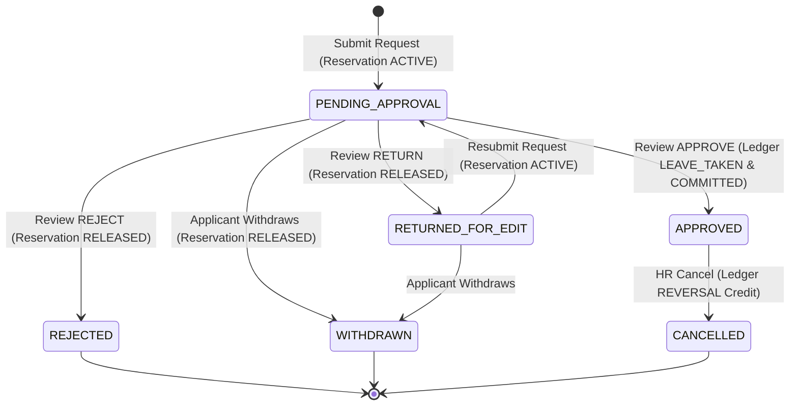
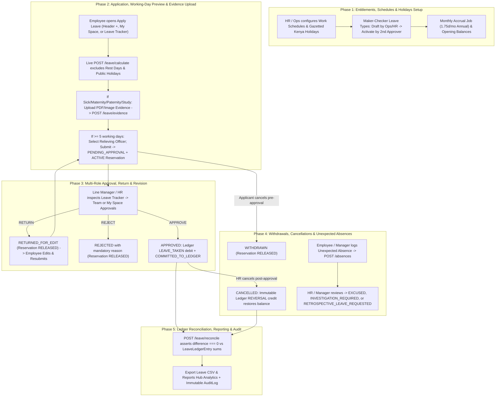

# Ndakala Advisory LLP — Leave & Absence Lifecycle Operational Guidance

This document provides definitive guidance on **Leave & Absence Management**, status definitions, ledger accounting, Kenya Employment Act compliance, and end-to-end operational workflows within the **Ndakala Advisory HR & People Operations Platform**.

---

## 1. Status Definitions

### 1.1 Leave Request Lifecycle (`LeaveRequest.status`)

| Leave Status | Operational Meaning | Technical Transition Trigger |
| :--- | :--- | :--- |
| **`PENDING_APPROVAL`** | **Awaiting Line Manager / HR Review.** Submitted via **Apply Leave** or **Resubmit**. Working days have been calculated against the employee's `WorkSchedule` and `PublicHoliday` calendar, and an `ACTIVE` `LeaveReservation` holds `pendingReservedDays` on `LeaveBalance` to prevent double-booking. | Created via `POST /api/v1/leave/requests` or resumed via `POST /api/v1/leave/requests/:id/resubmit`. |
| **`RETURNED_FOR_EDIT`** | **Returned by Approver for Corrections.** The reviewer requested date, handover, or supporting-document adjustments (`decision: 'RETURN'`). The `LeaveReservation` is marked `RELEASED` and `pendingReservedDays` is freed until resubmitted. | Set via `POST /api/v1/leave/requests/:id/review` (`RETURN`). |
| **`APPROVED`** | **Approved & Committed to Ledger.** The reviewer approved the request (`APPROVE`). An immutable negative `LEAVE_TAKEN` entry is appended to `LeaveLedgerEntry`, `takenDays` increases, `pendingReservedDays` clears, `closingBalanceDays` decrements, and the reservation becomes `COMMITTED_TO_LEDGER`. | Set via `POST /api/v1/leave/requests/:id/review` (`APPROVE`); self-approval blocked except `managing_partner`. |
| **`REJECTED`** | **Declined by Approver.** Denied with a mandatory rejection reason (>= 3 chars). `LeaveReservation` is `RELEASED` and reserved balance is restored. | Set via `POST /api/v1/leave/requests/:id/review` (`REJECT`). |
| **`WITHDRAWN`** | **Withdrawn Before Approval.** Applicant (or HR with `leave.manage`) withdrew a `PENDING_APPROVAL` or `RETURNED_FOR_EDIT` application (or superseded it via `replaceOverlapping: true`). `LeaveReservation` is `RELEASED`. | Set via `POST /api/v1/leave/requests/:id/withdraw`. |
| **`CANCELLED`** | **Post-Approval Cancellation with Ledger Reversal.** HR cancelled an `APPROVED` leave request with a mandatory reason. An immutable positive `REVERSAL` entry credits days back to `LeaveLedgerEntry` and `LeaveBalance.closingBalanceDays`. | Set via `POST /api/v1/leave/requests/:id/cancel` (`leave.manage`). |

### 1.2 Unexpected Absence Statuses (`AbsenceRecord.status` — Policy D-11)

> [!IMPORTANT]
> Per **BRS/FRS Guardrail D-11**, logging an unexpected or unnotified absence **never triggers automatic disciplinary sanctions or termination**. Any follow-up requires formal HR/Manager review or ER investigation.

| Absence Status | Operational Meaning | Trigger |
| :--- | :--- | :--- |
| **`RECORDED`** | Standard unexpected absence logged (e.g. `SICKNESS`, `FAMILY_EMERGENCY`, `MEDICAL_APPOINTMENT`, `OTHER`). Line manager notified automatically. | Default on `POST /api/v1/absences` when `reasonCategory !== 'UNNOTIFIED'`. |
| **`INVESTIGATION_REQUIRED`** | Flagged for welfare check & HR follow-up when no advance notice was given (`reasonCategory = 'UNNOTIFIED'`) or escalated by reviewer. | Auto-set on `UNNOTIFIED` or via `POST /api/v1/absences/:id/review`. |
| **`EXCUSED`** | Reviewed and excused by Manager/HR after verification (e.g. emergency explanation accepted). | Set via `POST /api/v1/absences/:id/review` (`EXCUSED`). |
| **`RETROSPECTIVE_LEAVE_REQUESTED`** | Absence is linked to a retrospective leave application (`isRetrospective = true`) for formal ledger accounting. | Set via `POST /api/v1/absences/:id/review` (`RETROSPECTIVE_LEAVE_REQUESTED`). |

---

## 2. Kenya Statutory Floors & Ndakala Leave Policy Guardrails

| Policy Code | Leave Type | Default Entitlement | Statutory Floor | Evidence Required | Accrual Method |
| :--- | :--- | :---: | :---: | :---: | :--- |
| `ANNUAL` | Annual Leave (D-01, D-19) | `21` working days/yr | `21` days | Optional | `MONTHLY_ACCRUAL` (`1.75` days/mo) |
| `SICK` | Sick Leave (D-03) | `52` days (`45` full + `7` half) | `14` days (`7` full + `7` half) | **Yes** (`MEDICAL`) | `ANNUAL_FRONTLOAD` |
| `MATERNITY` | Maternity Leave (D-04) | `120` days (4 months full pay) | `90` days (3 months) | **Yes** (`BIRTH_CERTIFICATE`) | `NONE` |
| `PATERNITY` | Paternity Leave (D-05) | `14` working days | `14` days | **Yes** (`BIRTH_CERTIFICATE`) | `NONE` |
| `COMPASSIONATE` | Compassionate / Bereavement (D-08) | `5` days | — | Optional | `ANNUAL_FRONTLOAD` |
| `STUDY` | Study & Examination Leave (D-07) | `5` days | — | **Yes** (`EXAM_TIMETABLE`) | `NONE` |
| `UNPAID` | Unpaid Leave of Absence | Uncapped / Policy-led | — | Optional | `NONE` |

- **Working-Day Exclusion Calculator**: Evaluates each calendar day from `startDate` to `endDate` inclusive against the employee's assigned `WorkSchedule` (`restDays`, defaulting to firm calendar if unassigned) and gazetted `PublicHoliday`s (excluding weekends/rest days and public holidays). Single-day `isHalfDay` (`MORNING` / `AFTERNOON`) deducts `0.5` days.
- **5+ Day Relieving Officer Rule**: Requests of `5` or more working days require nominating a relieving officer (`handoverEmployeeId`) and handover summary.
- **Immutable Ledger & Reconciliation**: Posted `LeaveLedgerEntry` rows are append-only (`OPENING_BALANCE`, `ACCRUAL`, `LEAVE_TAKEN`, `ADJUSTMENT`, `REVERSAL`, `CARRY_FORWARD`, `EXPIRY`, `ENCASHMENT`). `LeaveBalance.closingBalanceDays` reconciles 100% against ledger sums.
- **Privacy Redaction (D-11 / ODPC)**: Confidential `reason` text is visible to the applicant and HR (`leave.view_all`) but redacted (`undefined`) in Team Calendar responses (`?teamOnly=true` / manager list). `MEDICAL` supporting evidence defaults to `MEDICAL_RESTRICTED` visibility.

---

## 3. The 5-Phase End-to-End Leave & Absence Process

