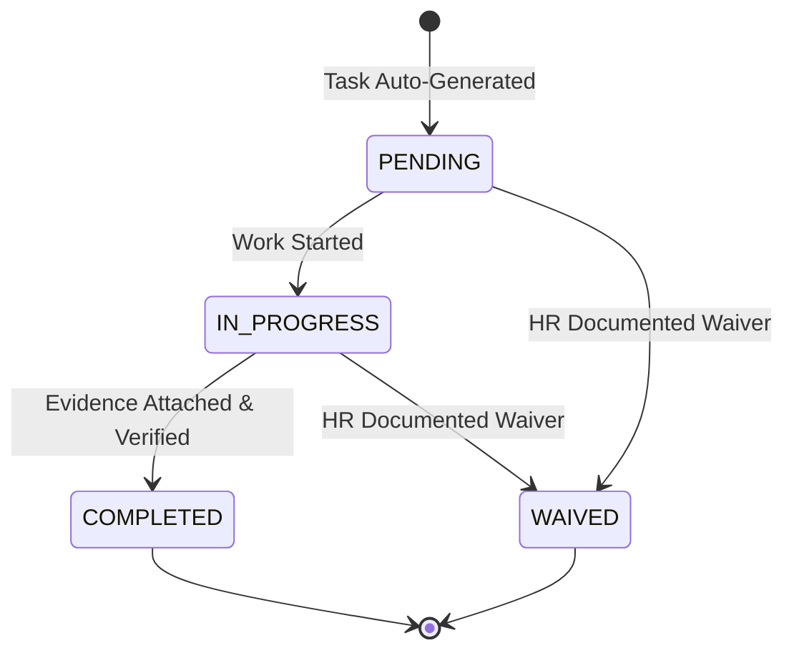
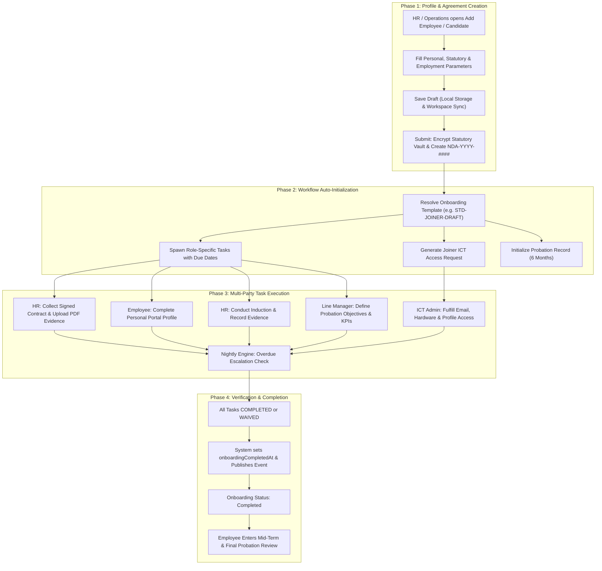

# Ndakala Advisory LLP — Onboarding Lifecycle & Operational Guidance

This document provides definitive guidance on the **Onboarding Lifecycle**, status definitions, and operational workflows within the **Ndakala Advisory HR & People Operations Platform**.

---

## 1. Onboarding Status Definitions

When navigating the **Workforce Directory** (`Onboarding` or `Employee Information` tabs), the **Onboarding Status** column reflects an employee's aggregate onboarding progress across the firm.

| Onboarding Status | Operational Meaning | Technical Transition Trigger |
| :--- | :--- | :--- |
| **`Triggered`** | **Initial Setup Stage.** The employee profile and employment agreement have been submitted. The platform has automatically provisioned their sequential employee number (`NDA-YYYY-####`), encrypted statutory identifiers, generated role-specific checklist tasks, and created the joiner ICT access ticket. Checklist execution has not yet commenced. | Default status assigned immediately upon creation via `POST /api/v1/employees`. |
| **`In Progress`** | **Active Checklist Execution Stage.** The employee is actively progressing through their assigned onboarding checklist and/or has transitioned into their probation period (`status = 'PROBATION'`). One or more tasks (such as induction sign-off, contract upload, or probation objective setting) are actively underway. | Set when any checklist task transitions to `IN_PROGRESS` or the employee's primary lifecycle status is set to `PROBATION`. |
| **`Completed`** | **Fully Onboarded Stage.** All assigned onboarding tasks have been finished (marked as `COMPLETED` with mandatory evidence attached or `WAIVED` by HR with documented justification). The platform stamps `onboardingCompletedAt` and transitions the employee into routine performance tracking. | Automatically triggered when `remaining_tasks = 0` via `PATCH /api/v1/onboarding-tasks/:taskId`. |

> [!NOTE]
> An employee's **Onboarding Status** is distinct from their primary **Lifecycle Status** (`ONBOARDING`, `PROBATION`, `ACTIVE`, `SUSPENDED`, `TERMINATED`, `RESIGNED`). An employee in `PROBATION` will remain `In Progress` in onboarding until their induction, contract evidence, and initial objectives are fully signed off.

---

### 1.1 Checklist Task-Level Statuses

Individual tasks inside the employee's **Onboarding Drawer** follow a strict compliance lifecycle:

* **`PENDING`**: The task has been generated and assigned to an owner (HR, Line Manager, Employee, or ICT), but action has not yet begun.
* **`IN_PROGRESS`**: The task assignee has commenced work (e.g., scheduling an induction meeting or gathering documentation).
* **`COMPLETED`**: The task is finalized.
  > [!IMPORTANT]
  > If a task has `evidenceRequired = true` (such as *Signed Employment Contract* or *Induction Completion*), the platform strictly rejects completion attempts that lack an attached document ID from the secure document vault.
* **`WAIVED`**: HR has approved bypassing this specific requirement.
  > [!WARNING]
  > Only HR administrators (`head_of_hr`, `operations_director`, `system_admin`) possess authority to waive onboarding tasks. A detailed `waiverReason` is mandatory and permanently logged in the audit trail.

---

## 2. The 4-Phase End-to-End Onboarding Process

---

### Detailed Phase Breakdown

### Phase 1: Candidate / Employee Record Creation
1. **Initiation**: HR or Operations opens the **Add Candidate** / **Add Employee** modal from the Workforce Directory.
2. **Data Capture**:
   * **Core Identity**: First name, Last name, Work email, Personal email, Phone number (Kenyan `+254` formatting).
   * **Statutory Compliance**: National ID, KRA PIN, NSSF Number, SHIF Number, and Banking details.
   * **Employment Contract Parameters**: Department, Category (`PERMANENT`, `CONTRACTOR`, `INTERN`), Grade/Level, Position, Work Location, and Start Date.
   * **Extended Profile**: Residential addresses, Education history, Prior work experience, and Dependents.
3. **Draft Resilience**:
   * Changes auto-save locally to `localStorage` (`ndakala_candidate_draft_v1`).
   * Clicking **Save Draft** persists the draft to `/api/v1/workspace/ui-config`, allowing cross-device and cross-session continuation.
4. **Transaction & Encryption**:
   * On **Submit**, sensitive statutory identifiers are encrypted using AES-256 Vault storage.
   * The platform assigns the next sequential employee number (e.g., `NDA-2026-0001`).
   * Generates `EmploymentAgreement` (Version 1) and initializes reporting line history.

---

### Phase 2: Workflow Auto-Initialization
Upon successful creation, the backend engine automatically triggers the joiner pipeline:
1. **Template Matching**: Matches active rules in `OnboardingTemplate` (such as `STD-JOINER-DRAFT`) based on department and category.
2. **Task Generation**: Spawns checklist items with explicit deadlines:
   * *Collect signed employment contract* (HR, Due: Start Date + 3 days, Evidence strictly required).
   * *Employee completes permitted personal details* (Employee self-service).
   * *Record induction completion* (HR, Due: Start Date + 7 days, Evidence required).
   * *Assign probation objectives* (Line Manager, Due: Start Date + 30 days).
   * *Record ICT provisioning status* (ICT Administrator).
3. **ICT Ticket Dispatch**: Dispatches a `JOINER` access request visible under **Workforce Operations → ICT Provisioning**.
4. **Probation Schedule**: Seeds a 6-month probation window with milestone notifications.

---

### Phase 3: Multi-Party Task Execution
Onboarding tasks are distributed across distinct organizational roles to ensure proper segregation of duties:

| Role | Responsibilities During Onboarding |
| :--- | :--- |
| **HR Lead / Operations** | Uploads the signed employment contract and NDA into the document vault; coordinates the firm-wide induction program; uploads attendance evidence; oversees overdue tasks. |
| **Employee (Joiner)** | Signs in to the employee portal; verifies personal contact details; acknowledges mandatory compliance policies and firm code of conduct. |
| **Line Manager** | Meets with the new hire within the first 30 days to establish clear, measurable Key Performance Indicators (KPIs) and probation objectives. |
| **ICT Administrator** | Sets up Office 365, secure credentials, corporate email, and hardware provisioning, then marks the joiner ICT ticket fulfilled. |

> [!TIP]
> A nightly platform cron job monitors task due dates. If a task exceeds its configured grace period, the system marks the task as `escalated = true` and dispatches notification alerts to senior leadership.

---

### Phase 4: Verification & Completion
1. When the final open task is completed or waived:
   * The platform verifies that all evidence-backed tasks have valid document attachments.
   * Updates the employee record with `onboardingCompletedAt = now()` and records the finalizing administrator's ID (`onboardingCompletedById`).
   * Dispatches the `ONBOARDING_COMPLETED` lifecycle event to system subscribers and audit logs.
2. In the Workforce Directory, the employee's badge transitions to **`Completed`**.
3. The employee moves seamlessly into the **Probation Evaluation Cycle**, where managers perform structured 3-month and 6-month confirmation reviews.
