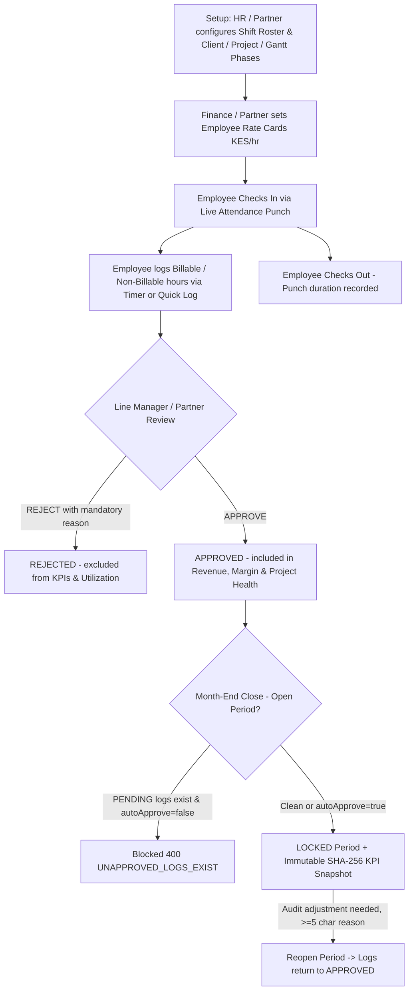
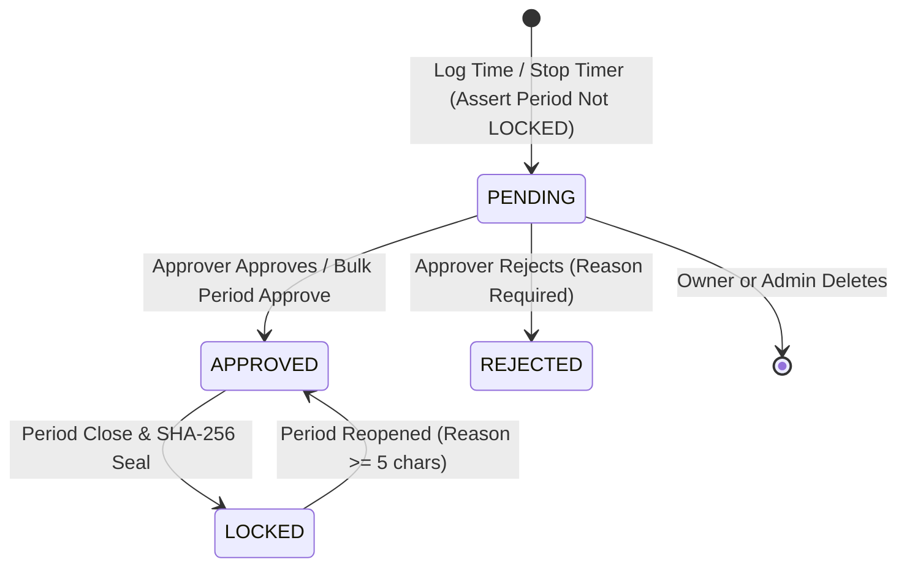

# Time Tracker, Shifts & Attendance — Process & Status Guidance

This guide explains every **Time Log**, **Financial Period**, **Project Health**, **Attendance Punch**, and **Shift Schedule** status in the Ndakala HR Platform (`ND-RUN-2026-10`), plus the end-to-end operational lifecycle from daily check-in and project time capture to manager approval, profitability analytics, and immutable SHA-256 period closing.

---

## 1. Navigation & Module Entry Points

- **Sidebar (`More Services` -> `Attendance` / `Time Tracker`)**: Opens `GovernanceView` in Time Tracker & Attendance mode with sub-tabs:
  - `Time Logs` (Quick stopwatch, inline project/phase entry, log table, filter drawer, 5-metric summary footer)
  - `Timesheets` -> embedded `TimeTrackerView` (`Time Logs & Timer`)
  - `Approvals` -> `Approvals Queue` (pending entries batch/single review)
  - `Projects & Gantt` -> `Clients, Projects & Gantt` (clients, budgets, phases, progress `%`, burn-rate health)
  - `Jobs & Rates` -> `Rate Cards (RBAC)` (internal cost rate vs client billing rate, gross spread)
  - `Period Lock` -> `Month-End Period Lock` (open, bulk approve, SHA-256 close/lock, reopen with reason)
  - `Profitability KPIs` -> executive revenue, cost, leakage, gross margin, and Mon–Fri utilization table
  - `Attendance & Absences` -> live web Check-In / Check-Out punches (`AttendancePunch`) + unexpected absence review
  - `Shift Schedules` -> shift roster catalog (`WS_SHIFTS_CATALOG`) with timings, break/grace minutes, active/paused toggle, and staff assignment
- **My Space -> Overview -> Attendance / Time Logs**: Quick personal Check-In/Check-Out widget, recent attendance punch log, and shortcuts into Attendance & Time Tracker.

---

## 2. Status Reference Tables

### A. Time Log (`TimeLog`) Statuses

| Status | Meaning | Who Triggers It | Permitted Next Actions |
|---|---|---|---|
| `PENDING` | Newly logged time entry (`hours` `0.25–24.0`) with point-in-time `costRateSnap` & `billingRateSnap` captured from `TimeRateCard` | Employee (`timetracker.log`) via quick entry or live timer | Owner deletes (`DELETE /logs/:id`); Approver (`timetracker.approve`) approves or rejects; Auto-approved on period close (`autoApprove: true`) |
| `APPROVED` | Validated by manager/HR/partner (`approvedById`, `approvedAt` recorded) | Approver (`timetracker.approve`) | Included in billing/profitability KPIs; sealed to `LOCKED` when financial period closes |
| `REJECTED` | Returned/rejected with **mandatory** `rejectionReason` | Approver (`timetracker.approve`) | Excluded from profitability & utilization KPIs |
| `LOCKED` | Permanently sealed under a closed `TimePeriodClose` (`periodId` linked) | Finance/Partner (`timetracker.periods.manage`) closing period | Immutable (`409 PERIOD_LOCKED` on edit/delete/review); reverts to `APPROVED` only if period is formally reopened |

### B. Financial Period (`TimePeriodClose`) Statuses

| Status | Meaning | Enforcement Rules |
|---|---|---|
| `OPEN` | Active accounting window (`startDate`..`endDate`, non-overlapping) | Staff can log/delete/approve time logs dated within the window |
| `LOCKED` | Closed period with immutable KPI `snapshotJson` and `snapshotChecksum` (SHA-256 digest) | **Hard block (`409 PERIOD_LOCKED`)** on creating, deleting, or reviewing any `TimeLog` inside `[startDate, endDate]`. Closing fails (`400 UNAPPROVED_LOGS_EXIST`) if `PENDING` logs remain unless `autoApprove: true` is used. Reopening requires a mandatory audit justification (>= 5 characters). |

### C. Project Health & Revenue Leakage Thresholds (`classifyProjectHealth`)

Burn rate is evaluated as:

$$\text{Burn \%} = \left(\frac{\text{Total Labor Cost (KES)}}{\text{Budget Amount (KES)}}\right) \times 100$$

| Health Status | Condition | Visual Signal |
|---|---|---|
| `ON_TRACK` | Burn `< 75%` (or `0` hours when budget is `0`) | Emerald (`On Track (<75%)`) |
| `WATCH` | `75% <=` Burn `<= 90%` | Amber (`Watch (75-90%)`) |
| `ATTENTION` | `90% <` Burn `<= 100%` | Orange (`Attention (>90%)`) |
| `OVER_BUDGET` | Burn `> 100%` | Rose (`Over Budget`) |
| `NO_BUDGET` | `budgetAmountKes <= 0` AND `totalHours > 0` | Rose (`No Budget (Leakage Risk)`) |

### D. Attendance Punch (`AttendancePunch`) & Shift Roster Statuses

- **Attendance Session**:
  - **Checked In (`clockOutAt = null`)**: Active workday shift punch (`workDate`, `clockInAt`, `source: 'WEB'`); live elapsed counter accumulates `todayCompletedSecs + liveSecs`. Duplicate check-in is idempotent (`alreadyCheckedIn: true`).
  - **Checked Out (`clockOutAt != null`)**: Shift closed with computed `totalSecs` and optional check-out notes; written to `AuditLog` (`ATTENDANCE_CLOCK_IN` / `ATTENDANCE_CLOCK_OUT`).
- **Shift Roster (`WS_SHIFTS_CATALOG`)**: `Active` (`isActive: true`) or `Paused` (`isActive: false`), configured by HR/Admin with `startTime`, `endTime`, `breakMinutes`, `gracePeriodMinutes`, and `assignedEmployeeIds`.

---

## 3. Role & RBAC Visibility Matrix

| Role | Self Attendance & Log Time | View Own Logs / All Staff Logs | Approve / Reject Logs | Create Clients / Projects / Phases | View & Edit Cost/Billing Rate Cards | Open / Lock / Reopen Periods |
|---|---|---|---|---|---|---|
| `employee` | Yes | Own logs only | No | No | Masked (`costRateSnap: null`) / No edit | No |
| `line_manager` | Yes | Team/all logs (`timetracker.approve`) | Yes | Yes (`timetracker.projects.manage`) | Masked (`costRateSnap: null`) / No edit | No |
| `head_of_hr` | Yes | All logs | Yes | Yes | View rates (`timetracker.rates.view`) / No manage | No |
| `payroll_officer` | Yes | Own logs (`timetracker.view` without `approve`) | No | No | View & Manage (`rates.view`, `rates.manage`) | Yes (`periods.manage`) |
| `managing_partner` / `operations_director` | Yes | All logs | Yes | Yes | View & Manage (full access) | Yes (`managing_partner`) / No (`operations_director` lacks `periods.manage`) |

---

## 4. End-to-End Operational Lifecycle Diagrams

